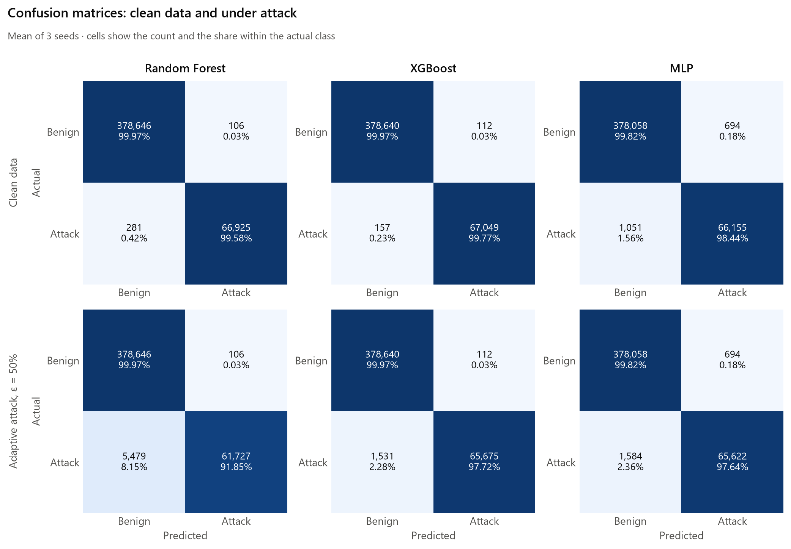
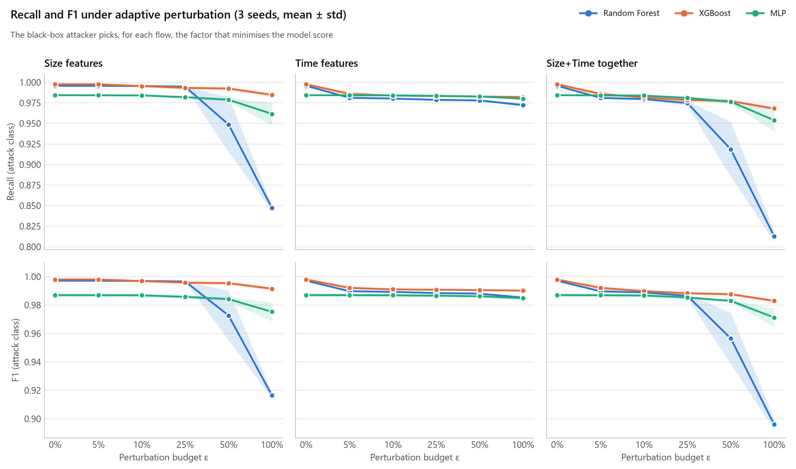
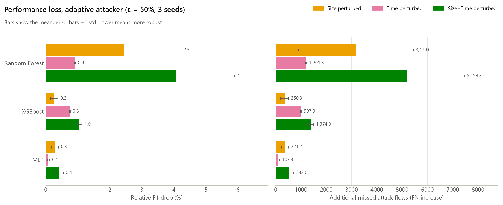
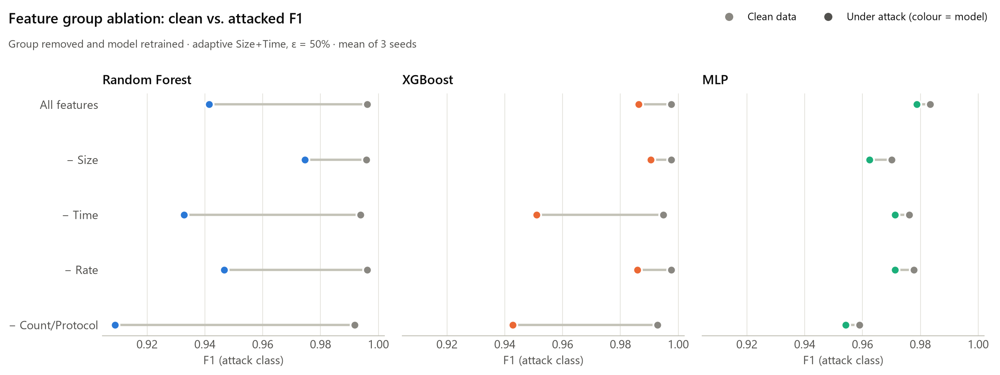
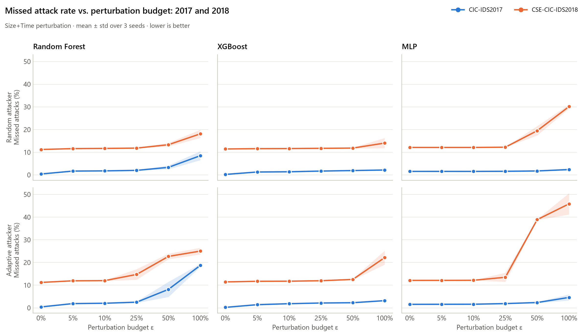
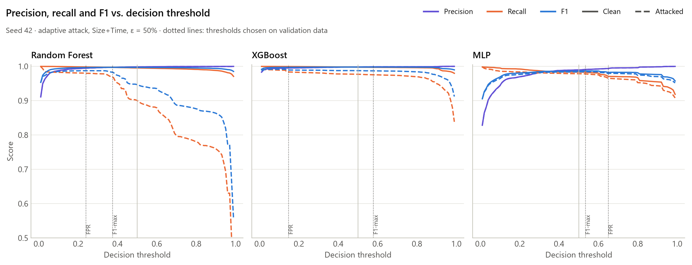

# Evaluating the Robustness of Machine Learning-Based Intrusion Detection Systems Against Adversarial Evasion Attacks

**Student:** Omer Faruk Sayin
**Turkish title:** Makine Öğrenmesi Tabanlı Saldırı Tespit Sistemlerinin Adversarial Evasion Saldırılarına Karşı Dayanıklılığının Değerlendirilmesi

> The explanations and comments in the notebooks are written in Turkish; all tables, figures and result files are in English. This README summarises the project in English.

## Project description and objectives

Machine learning-based intrusion detection systems (IDS) separate benign and malicious network traffic with very high accuracy on standard test data. This project asks whether that performance survives when an attacker makes small, realistic changes to their own traffic.

**Research question.** To what extent do adversarial perturbations reduce the performance of ML-based network intrusion detection models, and which model is more robust to them?

**Hypothesis H1.** As the perturbation level increases, the Recall and F1-score of the attack class decrease.

**Objectives**

- Train Random Forest, XGBoost and MLP classifiers on CIC-IDS2017 and report their baseline performance.
- Perturb only the attack flows in the test set under realistic network constraints, at six perturbation levels and with two attacker types.
- Compare the models' robustness, rank them, and identify which feature groups drive the loss.
- Repeat the experiment on CSE-CIC-IDS2018 to check whether the findings generalise to another dataset.
- Check the statistical reliability of the results (Holm correction, 95% confidence intervals).
- Test how much of the loss depends on the fixed 0.5 decision threshold and on probability calibration.

**Report.** The full IEEE-format report (in Turkish) is in [`report/`](report/): `rapor.pdf` and its LaTeX source.

## Technologies

| Purpose | Tools |
|---|---|
| Language and environment | Python 3.14 (Anaconda), Jupyter Notebook |
| Data processing | pandas, NumPy |
| Models and metrics | scikit-learn (Random Forest, MLP, metrics), XGBoost |
| Statistics | SciPy (Spearman rank correlation, t-based confidence intervals), Holm correction |
| Visualisation | Matplotlib |
| Report | LaTeX (IEEEtran conference template) |

Exact versions are listed in [`requirements.txt`](requirements.txt).

## Repository structure

```
├── notebooks/
│   ├── 00_cicids2017_robustness_experiments.ipynb      # CIC-IDS2017: cleaning, leakage analysis, experiments A–D
│   ├── 01_csecicids2018_replication_comparison.ipynb   # CSE-CIC-IDS2018: same pipeline, comparison with 2017
│   ├── 02_statistical_analysis.ipynb                   # Holm correction for H1, 95% confidence intervals
│   └── 03_threshold_calibration_error_analysis.ipynb   # decision threshold, calibration, error analysis, inference cost
├── results/
│   ├── graphs/           # figures from notebook 00 (2018/ for 01, calibration/ for 03)
│   └── metrics/          # tables as CSV, incl. raw per-seed results (2018/ for 01, statistics/ for 02, calibration/ for 03)
├── report/               # IEEE-format report (rapor.pdf), LaTeX source and figures
├── data/raw/             # datasets (not included in the repository, see below)
├── requirements.txt
└── README.md
```

## Installation and execution

**1. Install the dependencies**

```bash
pip install -r requirements.txt
```

**2. Download the datasets.** The raw data (about 3.5 GB) is not included because it exceeds GitHub's file size limit. Both datasets are published by the Canadian Institute for Cybersecurity (University of New Brunswick).

- **CIC-IDS2017.** From the [official dataset page](https://www.unb.ca/cic/datasets/ids-2017.html), download `MachineLearningCSV.zip` and extract its 8 CSV files into `data/raw/MachineLearningCVE/`.
- **CSE-CIC-IDS2018.** The [official dataset page](https://www.unb.ca/cic/datasets/ids-2018.html) hosts the data in the public AWS bucket `s3://cse-cic-ids2018/`. Download the files in `Processed Traffic Data for ML Algorithms/` into `data/raw/CSE-CIC-IDS2018/`, either with `aws s3 sync --no-sign-request` or over HTTPS, for example:

  ```bash
  curl -O "https://cse-cic-ids2018.s3.ca-central-1.amazonaws.com/Processed%20Traffic%20Data%20for%20ML%20Algorithms/Wednesday-14-02-2018_TrafficForML_CICFlowMeter.csv"
  ```

  This project uses 9 of the 10 daily files. `Thuesday-20-02-2018` (3.9 GB, DDoS-LOIC-HTTP only) was left out because of its size.

**3. Run the notebooks** from the `notebooks/` folder, in order, with *Kernel → Restart Kernel and Run All Cells*:

| Notebook | Content | Run time* |
|---|---|---|
| `00_cicids2017_robustness_experiments` | CIC-IDS2017 experiments A–D | ~35 min |
| `01_csecicids2018_replication_comparison` | CSE-CIC-IDS2018 experiments and comparison (reads the results of notebook 00) | ~20 min |
| `02_statistical_analysis` | Holm-corrected H1 tests and 95% confidence intervals (reads the saved results of 00 and 01) | seconds |
| `03_threshold_calibration_error_analysis` | Threshold policies, probability calibration, error analysis and inference time on CIC-IDS2017 (independent of the others) | ~15 min |

\*Measured on an Intel Core i5-11400H with 16 GB RAM. All figures and tables are written to `results/`.

## Method

**Data cleaning.** Infinite and missing values, physically invalid negative values, constant and duplicate columns, label conflicts (identical features with both labels) and duplicate rows are removed. CIC-IDS2017 goes from 2,830,743 to 2,229,788 flows with 64 features. `Destination Port` is excluded as an identifier rather than a behavioural feature.

**Evaluation protocol.** 80/20 stratified split, scaler fitted on the training set only, 3 seeds (42, 100, 2024) that change the split, the model initialisation and the perturbation. Results are reported as mean ± standard deviation. Metrics: Accuracy, Precision, Recall, F1, ROC-AUC, PR-AUC, and TN/FP/FN/TP for the attack class.

**Threat model and constraints.** Only attack flows are perturbed. The attacker controls only the packets they send (forward direction), can only pad packets and add delay, and cannot add or remove packets. Perturbations are applied in raw units as a relative budget ε ∈ {0, 5, 10, 25, 50, 100}%. Derived features (rates, bidirectional averages) are recomputed, integers stay integers, and every value stays within the range observed in training. A constraint check on 20,000 attack flows at ε = 100% confirms all 7 constraints.

**Attackers.**

- **Random:** draws a factor from 1 + U(0, ε) for each flow.
- **Adaptive (black-box):** queries the model's score and, for each flow, picks the factor combination that lowers the attack probability the most. It needs no gradients, so it applies equally to tree models and the MLP.

**Experiments.**

- A: baseline performance.
- B: perturbation sensitivity for size, time and size+time.
- C: robustness comparison and ranking.
- D: feature importance and feature group ablation (each group removed and the model retrained).
- Additional analyses: data leakage, class imbalance, and a Spearman test of H1.
- Statistics (notebook 02): Holm correction over the 36 Spearman tests per dataset and 95% confidence intervals over seeds.
- Threshold and calibration (notebook 03): 10% of the training set is held out as validation data. Three threshold policies (fixed 0.5, validation F1-max, validation false-positive rate ≤ 0.1%) and three calibration methods (Platt, isotonic, temperature scaling) are compared on clean data and under the adaptive attack. The test set is never used for any choice. The notebook also contains a per-attack-type error analysis, a false-positive analysis and inference times.

## Results

**Baseline (CIC-IDS2017, 3 seeds).**

| Model | F1 | Recall | PR-AUC | Missed attacks (FN) |
|---|---|---|---|---|
| Random Forest | 0.9971 ± 0.0002 | 0.9958 ± 0.0004 | 0.9999 | 281 |
| XGBoost | 0.9980 ± 0.0001 | 0.9977 ± 0.0003 | 1.0000 | 157 |
| MLP | 0.9870 ± 0.0014 | 0.9844 ± 0.0009 | 0.9988 | 1,051 |

**Under attack (adaptive attacker, size+time, ε = 50%).**

| Model | Relative F1 drop | FN (clean → attacked) | Rank |
|---|---|---|---|
| MLP | 0.41% | 1,051 → 1,584 | 1 |
| XGBoost | 1.04% | 157 → 1,531 | 2 |
| Random Forest | 4.07% | 281 → 5,479 | 3 |

**Key findings**

- **H1 is supported** in 17 of 18 model × attacker × feature group combinations (Spearman, p < 0.05), and in 14 of 18 after Holm correction; all combinations that lose support belong to the MLP. At ε = 100%, the Recall of Random Forest falls from 0.996 to 0.813.
- **Much of the loss comes from the fixed 0.5 threshold.** When the threshold is chosen on validation data with a 0.1% false-alarm budget, the attacks Random Forest misses under attack drop from 5,834 to 1,358 (−77%), while clean F1 barely changes (0.9971 → 0.9965). Calibration alone does not help, because it does not change the order of the scores.
- **The 2017 ranking is not fully separable with 3 seeds.** Random Forest's relative F1 drop varies strongly across seeds (95% CI [−0.45, 8.59]); only the XGBoost–MLP difference is clear. In 2018, all three models are clearly separated.
- **The loss is concentrated in Recall.** Precision stays almost unchanged, because benign traffic is never modified. Accuracy barely moves because 85% of the data is benign, which shows why accuracy alone is misleading here.
- **"Most robust" depends on the measure.** MLP loses the least relative to its own baseline, while XGBoost keeps the highest absolute F1 under attack (0.9876 vs 0.9829).
- **A 5% delay is enough to evade the tree models on slow DoS attacks.** 883 flows evade, most of them DoS Slowhttptest (52% of that class) and slowloris (31%). The models learned a fixed-duration signature (median 63.1 s) rather than the attack behaviour.
- **Ablation shows where robustness comes from.** Removing the size group makes Random Forest more robust (ΔF1 −0.055 → −0.021). Removing the counter/protocol features that the attacker cannot change makes it the least robust (ΔF1 −0.083).
- **No evidence of trivial leakage.** No train/test overlap, no single feature with ROC-AUC above 0.95, and adding `Destination Port` changes F1 only from 0.9975 to 0.9983.

**CSE-CIC-IDS2018 comparison**

- **The baseline is lower** (Recall ≈ 0.88), but 96–98% of the missed attacks belong to the *Infilteration* class, whose labels largely cover the victim's normal traffic. Without this class, Recall is 0.994–0.998, the same level as 2017.
- **The robustness ranking changes** to XGBoost > Random Forest > MLP. With 50% padding, the MLP's Recall on Bot drops from 0.975 to 0.039 and on SSH-Bruteforce from 0.999 to 0.004. These two attack types make up 27% of the 2018 attacks but only 1.4% of the 2017 attacks.
- **XGBoost is the only model that stays robust on both datasets.** A robustness ranking obtained on a single dataset should not be generalised.

### Figures

Confusion matrices on clean data and under the adaptive attack (ε = 50%):



Recall and F1 versus perturbation budget, adaptive attacker:



Relative F1 drop and additional missed attacks per model and feature group (ε = 50%):



Feature group ablation, clean vs. attacked F1:



Missed attack rate versus perturbation budget, CIC-IDS2017 vs. CSE-CIC-IDS2018:



Precision, recall and F1 versus decision threshold, clean vs. attacked (seed 42):



All other figures and tables are in `results/` and in the notebooks.

## Limitations

- **The attacks operate in feature space.** Packets are not regenerated. Bidirectional dispersion features are not updated, and the time perturbation assumes a proportional slowdown of the whole flow.
- **The adaptive attacker is assumed to have unlimited score queries.** Its results are an upper bound on what a real attacker could achieve.
- **Attack functionality is not measured.** The study does not check how much padding and delay reduce the effect of the attack itself.
- **CIC-IDS2017 was generated in a lab**, and a random split can place flows from the same attack session in both training and test sets.
- **For CSE-CIC-IDS2018, a 30% random sample of 9 daily files was used.** Feature importance, ablation and the threshold analysis were not repeated on it.
- **Only 3 seeds were used**, so the confidence intervals are wide.

The results show where the models are fragile. They are not proof that a real attacker could evade a deployed system.

## References

1. I. Sharafaldin, A. H. Lashkari, A. A. Ghorbani. "Toward Generating a New Intrusion Detection Dataset and Intrusion Traffic Characterization." *ICISSP*, 2018.
2. Canadian Institute for Cybersecurity. CIC-IDS2017 and CSE-CIC-IDS2018 datasets. https://www.unb.ca/cic/datasets/
3. B. Biggio, F. Roli. "Wild Patterns: Ten Years After the Rise of Adversarial Machine Learning." *Pattern Recognition*, 84, 2018.
4. I. J. Goodfellow, J. Shlens, C. Szegedy. "Explaining and Harnessing Adversarial Examples." *ICLR*, 2015.
5. T. Chen, C. Guestrin. "XGBoost: A Scalable Tree Boosting System." *KDD*, 2016.
6. F. Pedregosa et al. "Scikit-learn: Machine Learning in Python." *JMLR*, 12, 2011.
7. G. Apruzzese, M. Andreolini, L. Ferretti, M. Marchetti, M. Colajanni. "Modeling Realistic Adversarial Attacks against Network Intrusion Detection Systems." *Digital Threats: Research and Practice*, 3(3), 2022.
8. G. Engelen, V. Rimmer, W. Joosen. "Troubleshooting an Intrusion Detection Dataset: The CICIDS2017 Case Study." *IEEE SPW*, 2021.
9. A. Niculescu-Mizil, R. Caruana. "Predicting Good Probabilities with Supervised Learning." *ICML*, 2005.

The complete reference list (23 sources) is in the report.
